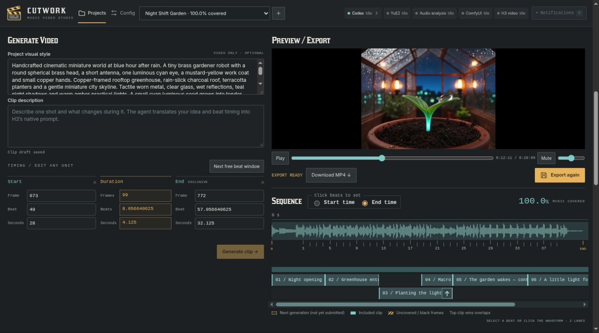
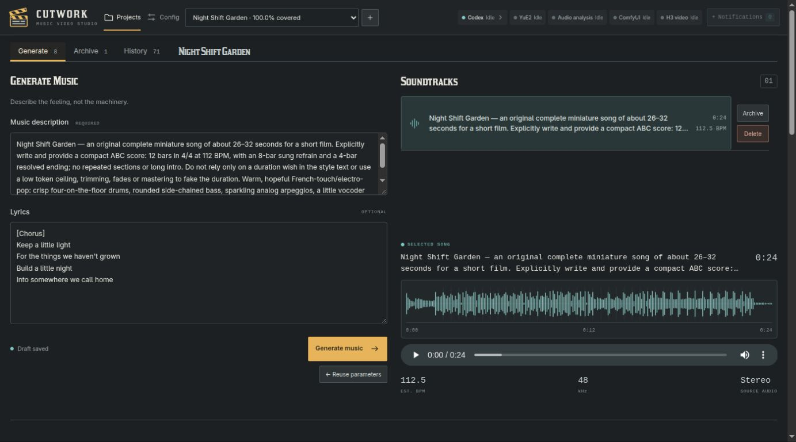
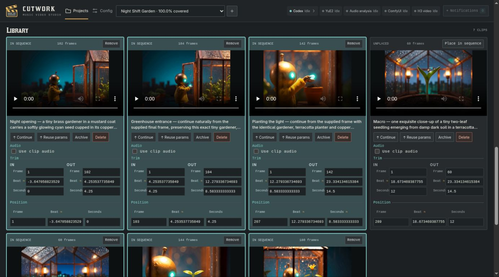
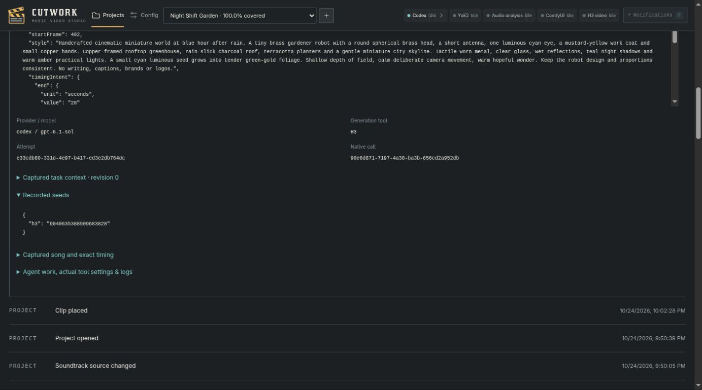

<p align="center"></p>

# Cutwork

### A creative workbench for AI-generated music videos

Cutwork brings **music generation, video direction, beat-aware editing and export**
into one browser workspace. Describe the sound and the shots you want; a frontier
agent translates your brief into the local generation tools' prompts and settings.
Then refine the result without rebuilding workflows or juggling output folders.

Run the tools on one Ubuntu/NVIDIA machine and open the interface from another
computer on your **trusted LAN**. The media models run locally; **Codex or Claude
uses its cloud provider**. This is not a fully offline application.

[Get started](#getting-started) · [See it in action](#see-it-in-action) ·
[User guide](docs/usage.md) · [Development](#development) ·
[Devpost process](#built-with-the-devpost-process)



## What you can do

- **Describe music in your own words.** Supply optional lyrics, generate a song
  with YuE2 and switch between takes with their original inputs intact.
- **Direct consistent shots.** Share a project visual style, condition H3 clips on
  the song, or continue from a clip's last retained original frame.
- **Edit precisely.** Work in linked beats, seconds or frames on a native 24 fps
  timeline. Trim, move, overlap and prioritise whole clips; keep video after the
  music ends.
- **Preview immediately.** Play the current arrangement without rendering first,
  then export an H.264/AAC MP4. Choose song audio or a dominant clip's own audio.
- **Iterate without losing the trail.** Reuse parameters for a fresh seeded take,
  archive/restore unused media, and inspect prompts, settings, seeds and outputs
  in the combined creative history.
- **Manage the toolchain in one place.** Guided installation, progress and retry,
  switchable agent providers, and editable agent templates and task-context guides.

## See it in action

**Night Shift Garden** is a completed 28-second demonstration: an original song,
six placed shots, four frame-based continuations, an overlapping macro insert,
and a closing image that continues beyond the music.

[](docs/media/night-shift-garden.mp4)

**[Watch or download the full 28-second film with audio →](docs/media/night-shift-garden.mp4)**
(4.3 MiB). The GIF is a silent, reduced-resolution excerpt; the MP4 is the unchanged
Cutwork export. Neither requires installing the app.

<details>
<summary><strong>Tour the interface — music, clip library and creative history</strong></summary>

### Music and lyrics

Describe the track, keep multiple takes, and inspect its waveform and estimated tempo.



### Sequence and clip library

Placed clips are highlighted. Each keeps its own preview, continuation/reuse
controls, audio choice, trim and position. Overlapping clips stay whole.



### Creative history

The project keeps a combined record of generations and edits, with expandable
inputs and tool details rather than only a folder of final files.



</details>

Screenshots show the real completed demo in a read-only documentation view; no
mock media or invented successful jobs. [Media provenance](docs/media/README.md).

## Requirements

| Component | Prototype target |
|---|---|
| Server | **Ubuntu 26.04 Desktop**, x86_64; a logged-in user with a working systemd user session |
| GPU | **NVIDIA, 16 GB VRAM**, working driver visible to `nvidia-smi` |
| System RAM | Tested on a 22 GiB host with a competing memory-heavy service paused; not a guaranteed minimum or all-workloads fit |
| Disk | Substantial free local space for models, isolated environments and original frames. H3 weights alone are about **35.1 GB** |
| Agent | A signed-in **Codex or Claude** account with access to the pinned model; provider quota/charges apply |
| Network | Internet for downloads and agent providers; a **trusted LAN** for browser access |
| Client | A modern desktop browser; no local GPU or generator install needed on the client |

Smaller GPUs, other operating systems and distributed generation services are not
validated targets. Models are downloaded during setup, **not bundled in this repo**.

> [!WARNING]
> **Trusted LAN only. No user accounts; full-access agents.** Anyone who can reach
> the interface can submit work, delete managed media and approve autonomous Debug
> repairs as the server user. Agents retain their normal tools and filesystem/network
> access. Project directories are organisational boundaries, **not sandboxes**.
> Do not expose Cutwork to the public Internet or an untrusted network.

## Getting started

### 1. Prepare the Ubuntu server

Clone/download this repository and open a terminal in its root **on the GPU
machine**, as the user who will run Cutwork. Keep the checkout in a stable location:
the service runs from it. Do not run the whole bootstrap as root.

```sh
# Inspect prerequisites and the installation plan; changes nothing.
bash scripts/bootstrap-ubuntu.sh

# Install host dependencies, pinned runtime, app and persistent user service.
bash scripts/bootstrap-ubuntu.sh --install --host-deps --service
```

APT may ask for local administrator approval. The bootstrap installs native
prerequisites including FFmpeg/ffprobe, pinned Node/provider CLIs and the app. It
**does not install an NVIDIA driver, replace host Python, change the firewall or
stop other applications**. Generator/model installation comes next in the UI.

Open **`http://<your-server-name-or-IP>:9122/`** from your browser. `9122` is the
shipping default; a customised installation may use another port.

### 2. Choose and sign in to an agent

Choose **Codex** or **Claude** in setup. Use the normal login flow in a terminal on
the server, as the same user who runs the service:

```sh
bash scripts/provider.sh codex login --device-auth
# Or, if you selected Claude:
bash scripts/provider.sh claude auth login
```

The helper selects Cutwork's pinned CLI; it is not a separate authentication
system. Click **Check sign-in** after completing login. The configured models are
`gpt-6.1-sol` and `claude-opus-5-5`; there is no hidden fallback if access fails.

### 3. Install the tools

Click **Install all**, or install individual steps. YuE2, ComfyUI/H3 and audio
analysis use isolated Python environments. Progress survives a browser refresh;
failed steps offer details and Retry. Large model downloads and first generations
can take a long time—this is not an instant cloud demo.

### 4. Make a first video

Create a project → describe music and optional lyrics → generate a soundtrack →
set a visual style and describe a short clip → generate → use **↑ Continue** or
create another shot → adjust the sequence → play the live preview → **Export MP4**.
Start with short clips. Tempo and song duration are estimates/outcomes, not exact
promises made by the model.

**[Full installation, service and configuration guide](docs/installation.md)** ·
**[Editing, audio, recovery and deletion guide](docs/usage.md)**

## Tech stack

| Layer | Technology / responsibility |
|---|---|
| Browser | **TypeScript, React 19, Vite 8**, custom CSS/SVG and browser media playback |
| Server | **Node.js 24, Fastify 5**, same-origin UI/API |
| State | **SQLite** via `better-sqlite3`; durable jobs, project records and immutable generation captures |
| Creative agents | **Codex / Claude CLI**, normal tools and natural-language responses; per-project working directories |
| Music | **YuE2**, through a managed Python integration |
| Video | **MiniMax H3 via ComfyUI**; song/image conditioning and preserved pre-encode PNG frames |
| Analysis / export | **Librosa**, **FFprobe / FFmpeg**, exact rational timing on a 24 fps grid |
| Execution | Linux processes and **systemd user units**, persisted shared GPU queue and owned-job cancellation |
| Verification | **Vitest**, TypeScript checks, CPU fixtures and separately opted-in native/model tests |

[Exact tool pins](integrations/tool-manifest.json) ·
[Generation knowledge and prompting guides](integrations/knowledge/README.md) ·
[Technical specification](devpost/spec.md)

## Development

Use Node **24**; the bootstrap prepares the pinned version. Put its reported `bin`
directory first on `PATH`. From the repository root:

```sh
npm ci --ignore-scripts --no-fund
npm run typecheck
npm test
npm run build
npm start
```

The default tests use fixtures: **no provider spending or model inference**.
See [tests/README.md](tests/README.md) before opting into native/live tests.

For UI development, run `npm start` in one terminal and `npm run dev` in another.
Vite serves `http://127.0.0.1:5173/` and proxies the API to port `9122`; it is not
itself the complete app. Use a separate `STUDIO_DATA_ROOT` for development rather
than modifying your working studio's projects. See [CONTRIBUTING.md](CONTRIBUTING.md).

| Directory | Start here for… |
|---|---|
| `apps/web/src/` | Workspace, clip controls, timeline, live preview and Config |
| `apps/server/src/studio/` | Project API, persistence, generation, lifecycle and render orchestration |
| `apps/server/src/jobs/` | Shared GPU work, process ownership and cancellation |
| `packages/core/src/` | Shared contracts and timing/arrangement rules |
| `integrations/` | Pinned recipes, Python adapters, Comfy workflow and agent knowledge |
| `scripts/` | Bootstrap, provider launcher and service setup |
| `devpost/` | Scope, requirements, specification, decisions and verification evidence |

## Built with the Devpost process

The project followed **Build With AI: Basics** as a sequence of distinct artifacts,
not one all-purpose vision document:

| Stage | Project artifact | What it settled |
|---|---|---|
| 1 — Start | Learner context, kept private | Project motivation and working approach |
| 2 — Scope | [Scope](devpost/scope.md) | The useful prototype and what to defer |
| 3 — PRD | [Product requirements](devpost/prd.md) | User journey, behaviour and edge cases |
| 4 — Spec | [Technical specification](devpost/spec.md) | Components, data, deployment and tool contracts |
| 5 — Build | [Checklist](devpost/checklist.md), [evidence map](devpost/prd-traceability.md) | Tests-first slices, review, real generation and feedback-driven refinement |
| 6 — Ship preparation | [Recorded demo](devpost/recorded-demo-v2.md), this README | Shareable technical documentation and demo assets; submission is authored by the developer |

The build began with explicit review before implementation, then moved to an
approved fast mode for the deadline. The documents retain failures, corrections
and limits as well as successes. The [app map](devpost/app-map.html) is a compact
code-navigation guide (download/open the HTML locally).

## Status and limits

**Working proof of concept.** Fresh managed-tool installation, Claude song/clip
generation, a complete Codex music-video journey and MP4 export have been recorded.
This reused a prepared Ubuntu host and existing provider sign-in; it is **not a
fresh-OS certification**. The latest code verification is **1,510 tests in 114 files**,
plus typecheck/build and targeted browser checks.

- One recorded Claude process remained alive after finishing its report; normal
  completion followed a targeted operator interrupt. Four follow-up probes did
  not reproduce it. It remains an intermittent issue to investigate, not a claimed
  fix. [Investigation](devpost/post-demo-issue-investigation.md).
- Generation is slow and resource-heavy; no universal timing, memory-fit, exact
  song length or seamless-continuation guarantee. Beat detection is an estimate.
- No accounts, distributed discovery, separate image/foley generation, fades or
  transitions, mastering, or arbitrary export frame rates in this prototype.
- A further accessibility sweep was explicitly deferred; no comprehensive
  accessibility certification is claimed.

## Licence

**Application source and original Cutwork mark: [MIT](LICENSE).**
Models, tools, codecs and the bundled historical Kirsty font retain their own
terms. The app's MIT licence does **not** relicense those components or guarantee
unrestricted rights to generated outputs. Read [third-party notices](THIRD_PARTY_NOTICES.md)
and [demo-media provenance](docs/media/README.md).
